<p align="center">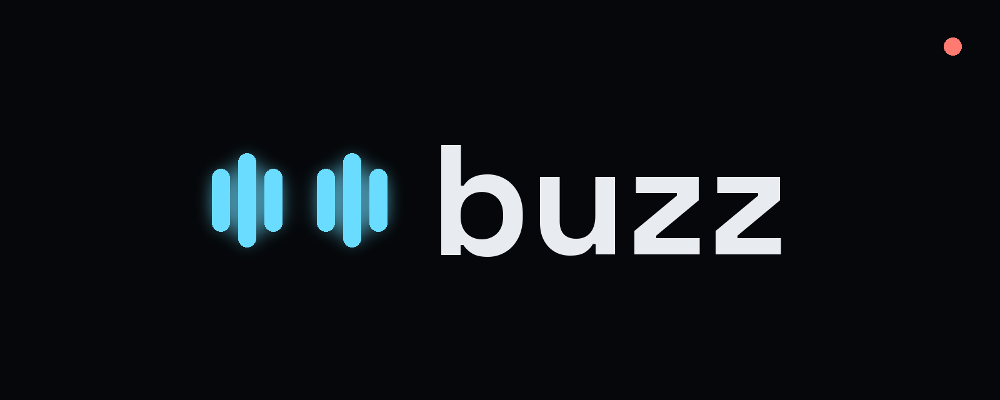</p>

# Buzz Eyes

Animated expressive eyes for a small hardware character (Buzz), currently prototyped in the browser.

This is a visual and animation layer meant to run on constrained screens (ESP32, Flipper Zero, or similar) while staying simple enough to port. The HTML demo is the current source of truth for shapes, timing, and personality.

## What this is

A parametric eye system that draws two eyes on a light-blue screen using Canvas 2D. Eyes morph between moods (neutral, happy, mad, sad, cute, love, playful, etc.) with smooth interpolation. Idle behavior includes looking around, occasional leans, and rare blinks so the character feels alive even when nothing is happening.

The target look is inspired by simple stylized eyes (EVE from WALL-E, lilguynet-style hardware) rather than realistic eyes: clear shapes, strong silhouettes, and readable emotion at small size.

## Why it exists

Buzz is a small physical character. The eyes are the main way it shows personality. We need:

- Distinct, readable emotions
- Smooth transitions so mood changes don't pop
- Idle motion that feels curious instead of mechanical
- Something simple enough to port to an ESP32 or similar without a full rendering engine

The browser demo lets us iterate on shapes and timing before writing the hardware version.

## How it works (short)

- Each mood is a set of numbers: eye width/height, corner radius, gap, vertical offset, rotation, top/bottom pinch.
- Every frame the current values lerp toward the target mood.
- A `drawEye` function picks a shape based on those values (rounded rect, half-circle, heart, smile arc, wink, etc.).
- Idle logic slowly drifts the gaze, occasionally leans one eye in, and triggers rare blinks (skipped on happy/love).

See [docs/ARCHITECTURE.md](docs/ARCHITECTURE.md) for the full parameter list and shape rules.

## Quick start

1. Open `buzz_eyes_demo.html` in a browser.
2. Click the mood buttons to switch expressions.
3. Leave it idle to see looking-around and blinks.

No build step. No dependencies.

## Repo layout

```
.
├── README.md                 ← you are here
├── buzz_eyes_demo.html       ← live prototype (source of truth)
├── flipper/
│   └── buzz_eyes/            ← Flipper Zero app (Signal eyes)
├── tools/
│   ├── export_expressions.py ← renders the expression GIFs below
│   └── frame_dump.c
└── docs/
    ├── BRAND.md              ← brand kit: logo, colors, type, voice
    ├── brand/                ← logo, app icons, palette and type images
    ├── expressions/          ← animated previews of every expression
    ├── SCOPE.md              ← what is in / out of scope
    ├── ROADMAP.md            ← phases and next work
    ├── ARCHITECTURE.md       ← how the system is structured
    └── CONTRIBUTING.md       ← how to add moods or improve shapes
```

## Signal eyes

Buzz's signature look: each eye is **three vertical bars**, like a phone's signal meter. Emotion comes from the bar heights, motion is energy, and a small pixel symbol only shows up when the bars can't say it alone. Every preview below is rendered by the real animation engine at the actual 128x64 resolution of the 1.3" SH1106 OLED.

### All 24 expressions

|   |   |   |   |
|---|---|---|---|
| <br>**Idle**<br><sub>Default. Blinks every 3 to 5 s and glances around</sub> | 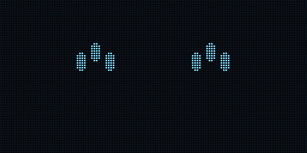<br>**Happy**<br><sub>Phone unlocked, pet key tapped, text from a favorite</sub> | 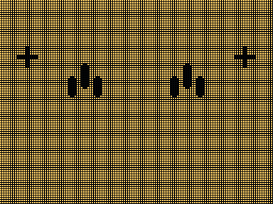<br>**Excited**<br><sub>Big news: likes spike, goal hit, package delivered</sub> | <br>**Love**<br><sub>Long-press pet, or your person texts</sub> |
| <br>**Listening**<br><sub>Hears a voice. Equalizer bounce with peak caps</sub> | 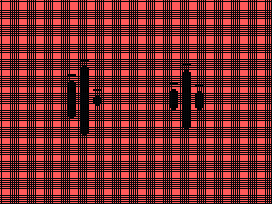<br>**Vibing**<br><sub>Music playing. Fast equalizer and a floating note</sub> | <br>**Surprised**<br><sub>Phone picked up fast or shaken</sub> | 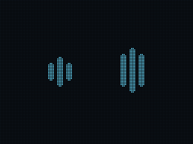<br>**Curious**<br><sub>Phone tilted slowly, new app opened</sub> |
| 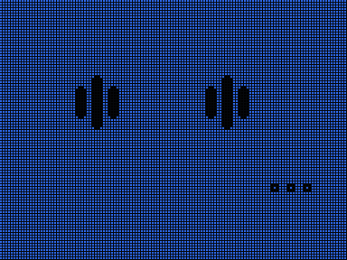<br>**Thinking**<br><sub>Waiting on Bluetooth sync or an app action</sub> | 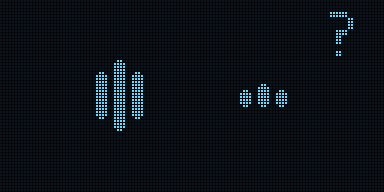<br>**Confused**<br><sub>Unknown key combo or a failed action</sub> | <br>**Sleepy**<br><sub>Night mode or no touch for a while</sub> | <br>**Bored**<br><sub>Face down for an hour with nothing happening</sub> |
| 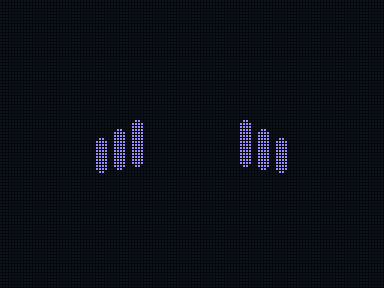<br>**Sad**<br><sub>Missed call or a message left on read</sub> | 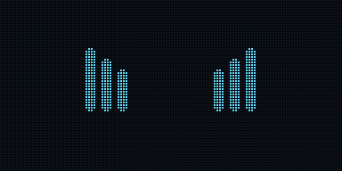<br>**Angry**<br><sub>Shaken hard or a screen-time limit hit</sub> | 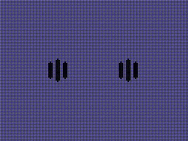<br>**Scared**<br><sub>Free fall or the phone hits the floor</sub> | 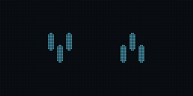<br>**Dizzy**<br><sub>Phone spun or flipped over and over</sub> |
| <br>**Focused**<br><sub>Focus mode or Do Not Disturb on</sub> | <br>**Wink**<br><sub>Double tap pet, or right after a photo</sub> | <br>**Shy**<br><sub>Petted many times in a row</sub> | 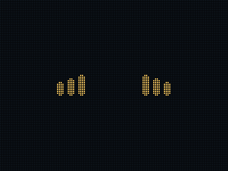<br>**Smug**<br><sub>A daily goal or streak was kept</sub> |
| 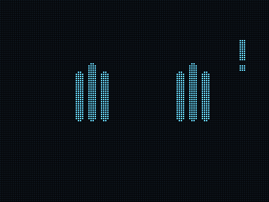<br>**Alert**<br><sub>New notification. Antenna bead glows too</sub> | 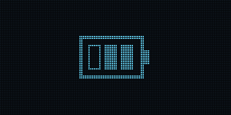<br>**Charging**<br><sub>Plugged into USB-C</sub> | <br>**Low battery**<br><sub>Buzz itself is under 15 percent</sub> | <br>**Glitch**<br><sub>Firmware error or lost Bluetooth</sub> |

### MagSafe moments

Expressions only a phone-back robot can have. The tag shows which sensor would trigger each one on the real device.

|   |   |   |   |
|---|---|---|---|
| 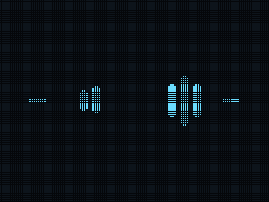<br>**Snap on** · `Hall sensor`<br><sub>Clicked onto the phone. Bars build like signal connecting</sub> | <br>**Bye for now** · `Hall sensor`<br><sub>Pulled off. Bars drop one by one</sub> | 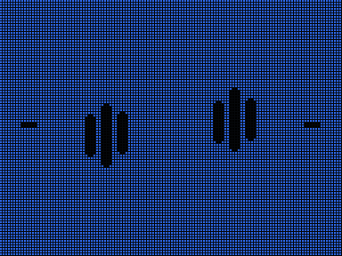<br>**Slipping** · `IMU`<br><sub>Rotating on the ring or knocked crooked</sub> | 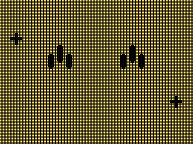<br>**My turn** · `IMU`<br><sub>Phone face down, so Buzz is the only face up</sub> |
| 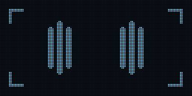<br>**Say cheese** · `App`<br><sub>Rear camera opens. Gets people to look</sub> | 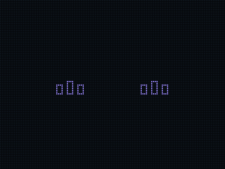<br>**Pocket mode** · `Light + IMU`<br><sub>Dark and moving. Dim glow saves battery</sub> | <br>**Find me** · `App + BLE`<br><sub>Tap Find Buzz. Signal waves and a chirp</sub> | 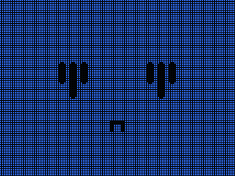<br>**Upside down** · `IMU`<br><sub>Phone flipped while Buzz is attached</sub> |

**Snap-on boot:** every time Buzz clicks onto a phone, the bars light up one by one (1 bar, 1 eye, full signal) over about 600 ms, then it says hello with a Happy face, a rising chirp and the antenna bead flashing. It plays the same way every time, so it works as Buzz's sound-and-light logo.

To regenerate these previews after changing a face, run `python3 tools/export_expressions.py`. It needs gcc and Pillow.

## Flipper Zero prototype

`flipper/buzz_eyes/` is a Flipper Zero app that plays every expression above on the Flipper's 128x64 screen, including the snap-on boot. Its animation engine is plain C with no Flipper code, so it can be reused on the ESP32. See [flipper/buzz_eyes/README.md](flipper/buzz_eyes/README.md) to build and install it.

## Brand kit

<p>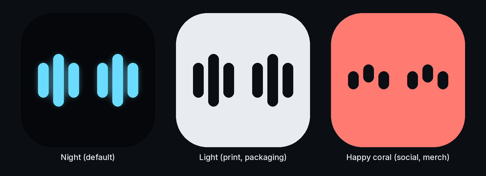</p>

- **Logo:** the Signal mark (two three-bar eyes) next to a lowercase **buzz** wordmark in Space Grotesk Bold. Versions for [dark](docs/brand/logo-dark.png) and [light](docs/brand/logo-light.png) backgrounds.
- **App icons:** [night](docs/brand/icon-night.png) (default), [light](docs/brand/icon-light.png) (print and packaging) and [happy coral](docs/brand/icon-coral.png) (social, stickers, merch), all 512x512.
- **Colors:** Signal Blue `#6ADCFF`, Night `#0B0E13`, Graphite `#2E333C`, Antenna Coral `#FF7A70`, Charge Mint `#7CFFB2`, Cloud `#E8ECF1`
- **Type:** Space Grotesk (headlines), Inter (body), JetBrains Mono (tech labels)
- **Tagline options:** "Always on your wavelength." / "Snap it on. Feel the signal." / "Your phone finally has a face."

Full guidelines, including the palette, type and rules for using the eyes, are in [docs/BRAND.md](docs/BRAND.md).

## Contributing

Read [docs/CONTRIBUTING.md](docs/CONTRIBUTING.md) before changing shapes or adding moods. The goal is to keep the system parametric and the demo self-contained so hardware ports stay easy.

## Related

Part of the broader DENIZEN / Dolonia work on expressive AI characters. This repo is focused only on the Buzz eye animation layer.
