<p align="center">
  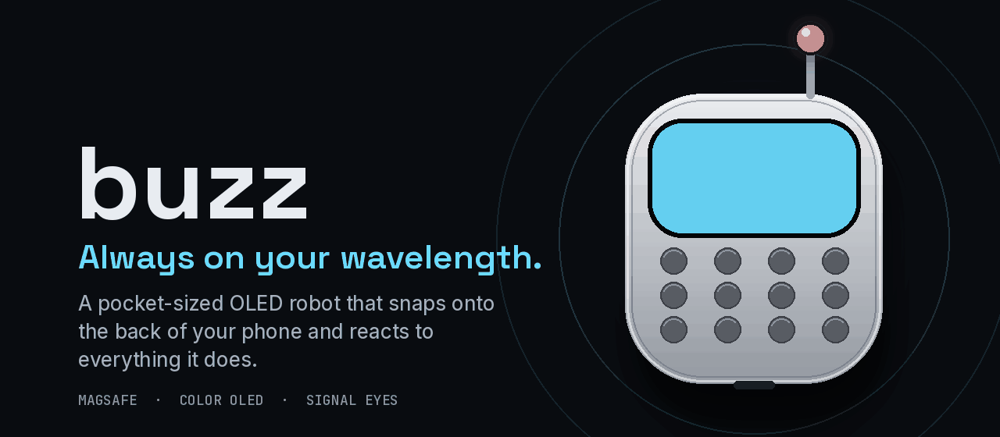
</p>

<p align="center">    </p>

<p align="center">
  <a href="#meet-buzz">Meet Buzz</a> ·
  <a href="#the-signal-eyes">Signal eyes</a> ·
  <a href="#magsafe-moments">MagSafe moments</a> ·
  <a href="#try-it-on-a-flipper-zero">Flipper app</a> ·
  <a href="#brand-kit">Brand kit</a>
</p>

---

## Meet Buzz

**Buzz is a pocket-sized OLED robot that snaps onto the back of your phone with MagSafe and reacts to everything your phone does.** Unlock your phone and it's happy. Play music and its eyes bounce to the beat. Put your phone face down and Buzz becomes the only face showing.

This repo is Buzz's face: the eyes, every expression, the animation engine that drives them, and the brand that grows out of them.

|  |  |  |
|:---:|:---:|:---:|
| **Snaps on** | **Feels what your phone feels** | **Lives on the back** |
| Clicks onto any MagSafe phone and wakes up with its signature boot. | Notifications, music, calls, motion. Buzz has a face for all of it. | The side of your phone nobody uses finally has a personality. |

## The Signal eyes

Buzz's signature look. Each eye is **three vertical bars**, like your phone's signal meter.

- **Height is feeling.** Tall bars are wide awake, short bars are tired, sloped bars are angry or sad.
- **Motion is energy.** Bars bounce, hop, tremble or drift depending on the mood.
- **Symbols are a last resort.** A tiny pixel heart, Zz, ! or ? shows up only when the bars can't say it alone.

Every preview here is rendered by the real animation engine on Buzz's 1.27" 128x96 full-color OLED, so what you see is exactly what the device shows. Buzz's screen is **blue with black eyes**, and the screen color changes with the mood: Screen Blue by default, sunny yellow for happy moments, coral for love, red for anger and errors, lavender for quiet and sad moods, mint for charging, and a moving rainbow for Vibing and Dizzy.

### All 24 expressions

|   |   |   |   |
|---|---|---|---|
| 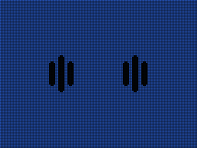<br>**Idle**<br><sub>Default. Blinks every 3 to 5 s and glances around</sub> | <br>**Happy**<br><sub>Phone unlocked, pet key tapped, text from a favorite</sub> | <br>**Excited**<br><sub>Big news: likes spike, goal hit, package delivered</sub> | 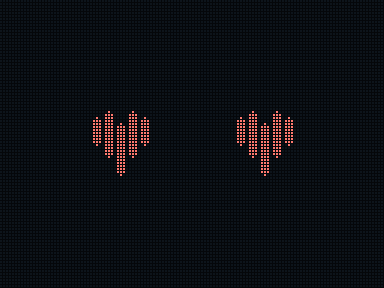<br>**Love**<br><sub>Long-press pet, or your person texts</sub> |
| 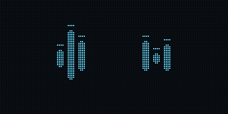<br>**Listening**<br><sub>Hears a voice. Equalizer bounce with peak caps</sub> | <br>**Vibing**<br><sub>Music playing. Fast equalizer and a floating note</sub> | 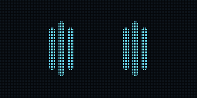<br>**Surprised**<br><sub>Phone picked up fast or shaken</sub> | <br>**Curious**<br><sub>Phone tilted slowly, new app opened</sub> |
| <br>**Thinking**<br><sub>Waiting on Bluetooth sync or an app action</sub> | <br>**Confused**<br><sub>Unknown key combo or a failed action</sub> | 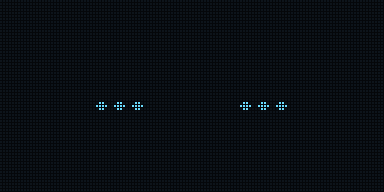<br>**Sleepy**<br><sub>Night mode or no touch for a while</sub> | 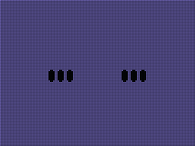<br>**Bored**<br><sub>Face down for an hour with nothing happening</sub> |
| <br>**Sad**<br><sub>Missed call or a message left on read</sub> | <br>**Angry**<br><sub>Shaken hard or a screen-time limit hit</sub> | <br>**Scared**<br><sub>Free fall or the phone hits the floor</sub> | <br>**Dizzy**<br><sub>Phone spun or flipped over and over</sub> |
| 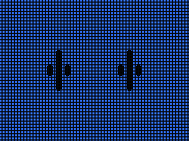<br>**Focused**<br><sub>Focus mode or Do Not Disturb on</sub> | 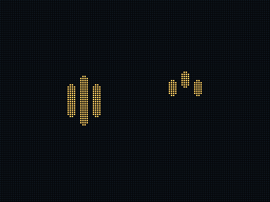<br>**Wink**<br><sub>Double tap pet, or right after a photo</sub> | 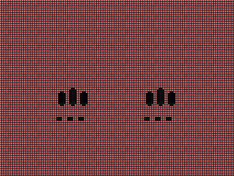<br>**Shy**<br><sub>Petted many times in a row</sub> | <br>**Smug**<br><sub>A daily goal or streak was kept</sub> |
| <br>**Alert**<br><sub>New notification. Antenna bead glows too</sub> | <br>**Charging**<br><sub>Plugged into USB-C</sub> | 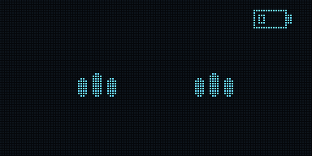<br>**Low battery**<br><sub>Buzz itself is under 15 percent</sub> | 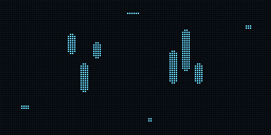<br>**Glitch**<br><sub>Firmware error or lost Bluetooth</sub> |

## MagSafe moments

Expressions only a phone-back robot can have. The tag shows which sensor triggers each one on the device.

|   |   |   |   |
|---|---|---|---|
| <br>**Snap on** · `Hall sensor`<br><sub>Clicked onto the phone. Bars build like signal connecting</sub> | 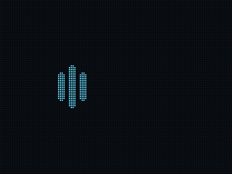<br>**Bye for now** · `Hall sensor`<br><sub>Pulled off. Bars drop one by one</sub> | <br>**Slipping** · `IMU`<br><sub>Rotating on the ring or knocked crooked</sub> | <br>**My turn** · `IMU`<br><sub>Phone face down, so Buzz is the only face up</sub> |
| <br>**Say cheese** · `App`<br><sub>Rear camera opens. Gets people to look</sub> | <br>**Pocket mode** · `Light + IMU`<br><sub>Dark and moving. Dim glow saves battery</sub> | 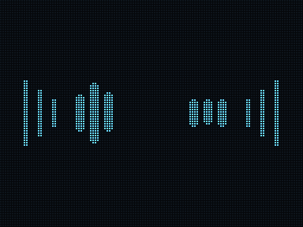<br>**Find me** · `App + BLE`<br><sub>Tap Find Buzz. Signal waves and a chirp</sub> | <br>**Upside down** · `IMU`<br><sub>Phone flipped while Buzz is attached</sub> |

### The snap-on boot

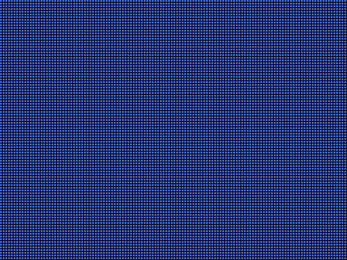

Every time Buzz clicks onto a phone, its bars light up one by one, like a phone finding signal:

1. **0 ms:** click, screen dark
2. **80 ms:** one bar
3. **200 ms:** one eye
4. **380 ms:** full signal
5. **600 ms:** a Happy hello, with a rising chirp and the antenna bead flashing

It plays the same way every time, so it doubles as Buzz's sound-and-light logo.

<br clear="right">

## What's inside

Prototype v0.1. These are the parts we're designing around, still to be confirmed with the first build.

| | |
|---|---|
| **Screen** | 1.27" full-color OLED, 128x96, 262K colors, SSD1351 driver ([Waveshare](https://www.waveshare.com/1.27inch-rgb-oled-module.htm)) |
| **Brain** | ESP32-C3 with Bluetooth LE |
| **Sensors** | 6-axis IMU (motion, tilt, free fall) and a hall-effect sensor (MagSafe attach and detach) |
| **Feedback** | RGB LED in the antenna bead, piezo buzzer, vibration motor |
| **Controls** | Twelve round keys in a 4 × 3 grid, BlackBerry style (see [The keypad](#the-keypad)) |
| **Body** | Silver shell, USB-C charging port on the bottom edge |
| **Attach** | MagSafe-compatible magnet ring with an alignment magnet |
| **Power** | Small LiPo cell, USB-C charging |
| **Size** | About 56 x 63 x 9 mm (target) |

## The keypad

Twelve round keys in a 4 × 3 grid, BlackBerry style. Every press gets a reaction: Buzz's face responds, the vibration motor gives a short tap, and the action happens on the phone over Bluetooth.

| | | | |
|---|---|---|---|
| **Pet** · Buzz goes Happy, hold for Love | **Mood** · cycle Buzz's face | **Music** · play/pause, hold to skip | **Camera** · opens the camera, Buzz plays Say cheese |
| **Reply 1** · send a saved quick reply | **Reply 2** | **Reply 3** | **Find my phone** · rings the phone |
| **Focus** · toggles Do Not Disturb, Buzz goes Focused | **Mute** · silences Buzz's sounds | **Game** · mini games played with the keys | **Back** · cancel, hold for settings |

Ideas for making the keys feel alive:

- **Instant feedback.** Each key gets its own face reaction within one frame, plus a haptic tap.
- **Short and long press.** Every key has a second action on hold, so 12 keys cover 24 actions.
- **Assignable.** The companion app lets you choose what Reply 1 to 3, Game and Mood do.
- **Mini games.** Simon Says (Buzz flashes a pattern on the screen, you repeat it on the keys), Pet streaks, a reaction-time game.
- **Number pad mode.** Hold Back + Mood to type numbers, for things like a quick timer.

The keys are wired as a 4 × 3 matrix so all twelve use only seven pins on the XIAO.

## Take Buzz apart

`prototype/take-buzz-apart.html` is an interactive 3D teardown of the prototype. Open it in any browser (no build step): drag to rotate, explode it into its nine layers, tap a part to see why it's there, why it's the pick for the prototype and where to buy it, and run all 32 color expressions on its screen. **Snap it on** plays the boot sequence with the chirp. It also has the full parts list with quantities and prices.

## Try it on a Flipper Zero

The Flipper Zero's 128x64 screen is the same width as Buzz's face, so it's the fastest way to see the eyes move on real hardware. It's monochrome, so it shows the shapes and timing; the color shows up on the real panel and in the previews above. The app plays all 32 expressions plus the snap-on boot, flashes the LED like the antenna bead and chirps on startup.

```bash
pip install ufbt
cd flipper/buzz_eyes
ufbt launch        # builds, installs and opens it on a Flipper plugged in over USB
```

| Button | Action |
|---|---|
| Left / Right | Previous / next expression |
| OK | Replay the snap-on boot |
| Up | Auto demo on/off |
| Down | Invert the screen |
| Back | Exit |

Full details are in [flipper/buzz_eyes/README.md](flipper/buzz_eyes/README.md).

## Under the hood

The engine is plain C with no Flipper code in it, so the same files run on the ESP32.

- **Faces are data.** Every expression in `buzz_faces.c` is a list of bars: position, height and which animation to use.
- **The engine draws rectangles.** Give `bz_engine_render()` the time in milliseconds and it returns the rectangles to draw. Any screen library can draw those, like the Flipper's Canvas or U8g2 on the ESP32.
- **Tiny frames.** Each eye is three bar heights, so a frame is six numbers. Smooth animation without storing images.
- **Previews stay in sync.** `python3 tools/export_expressions.py` re-renders every GIF in this README from the real engine after you change a face.

### Browser prototype

The original parametric eye demo is still here in `buzz_eyes_demo.html`. It draws two eyes on a light-blue screen with Canvas 2D and morphs between moods (neutral, happy, mad, sad, cute, love, playful and more) with smooth interpolation. Idle behavior includes looking around, occasional leans and rare blinks.

- Each mood is a set of numbers: eye width and height, corner radius, gap, vertical offset, rotation, and top and bottom pinch.
- Every frame, the current values lerp toward the target mood.
- A `drawEye` function picks a shape from those values (rounded rect, half-circle, heart, smile arc, wink and so on).

To try it, open `buzz_eyes_demo.html` in a browser and click the mood buttons. There's no build step and no dependencies. See [docs/ARCHITECTURE.md](docs/ARCHITECTURE.md) for the full parameter list and shape rules.

## Brand kit

<p align="center"></p>

<p align="center"></p>

<p align="center"></p>

| | |
|---|---|
| **Logo** | The Signal mark (two three-bar eyes) with a lowercase **buzz** wordmark. [Dark](docs/brand/logo-dark.png) and [light](docs/brand/logo-light.png) versions |
| **App icons** | [Night](docs/brand/icon-night.png) (default), [light](docs/brand/icon-light.png) (print and packaging), [happy coral](docs/brand/icon-coral.png) (social and merch) |
| **Colors** | Screen Blue `#2E6BF0` (the device screen) · Signal Blue `#6ADCFF` · Night `#0B0E13` · Graphite `#2E333C` · Antenna Coral `#FF7A70` · Charge Mint `#7CFFB2` · Cloud `#E8ECF1` |
| **Type** | Space Grotesk for headlines, Inter for body text, JetBrains Mono for tech labels |
| **Personality** | Playful, responsive, loyal |
| **Taglines** | *Always on your wavelength.* · *Snap it on. Feel the signal.* · *Your phone finally has a face.* |

The full guide, with the rules for using the eyes and the moments to film for marketing, is in [docs/BRAND.md](docs/BRAND.md).

## Repo layout

```
.
├── README.md                 ← you are here
├── buzz_eyes_demo.html       ← browser prototype (parametric eyes)
├── prototype/
│   └── take-buzz-apart.html  ← interactive 3D teardown + parts list
├── flipper/
│   └── buzz_eyes/            ← Flipper Zero app and portable C engine (Signal eyes)
├── tools/
│   ├── export_expressions.py ← renders every expression GIF from the real engine
│   └── frame_dump.c
└── docs/
    ├── BRAND.md              ← brand kit: logo, colors, type, voice
    ├── brand/                ← hero, logo, app icons, palette and type images
    ├── expressions/          ← animated previews of every expression
    ├── SCOPE.md              ← what is in / out of scope
    ├── ROADMAP.md            ← phases and next work
    ├── ARCHITECTURE.md       ← how the browser prototype is structured
    └── CONTRIBUTING.md       ← how to add moods or improve shapes
```

## Contributing

Read [docs/CONTRIBUTING.md](docs/CONTRIBUTING.md) before changing shapes or adding moods, and check [docs/ROADMAP.md](docs/ROADMAP.md) for what's next. To add a Signal-eye expression, follow the steps in [flipper/buzz_eyes/README.md](flipper/buzz_eyes/README.md#adding-an-expression), then run `python3 tools/export_expressions.py` so this page shows it.

## Related

Part of the broader DENIZEN / Dolonia work on expressive AI characters. This repo focuses on Buzz's face: the eyes, the animation engine and the brand.

---

<p align="center">
  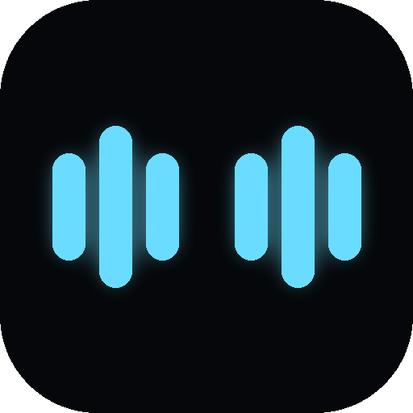<br>
  <b>buzz</b> · <i>Always on your wavelength.</i>
</p>
