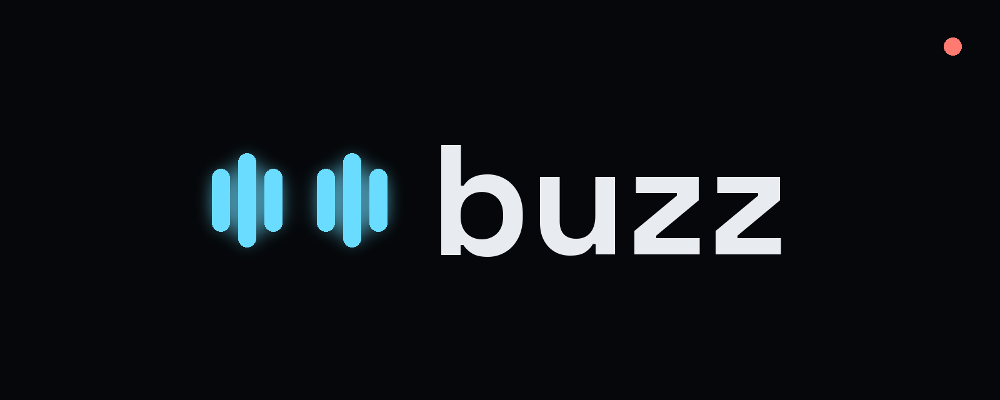
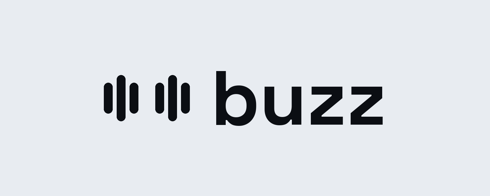
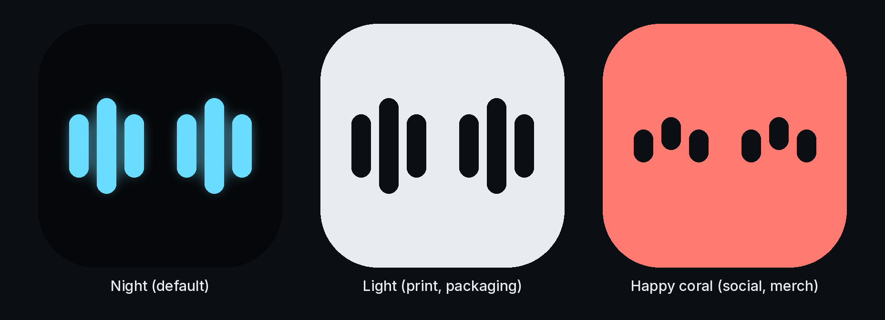
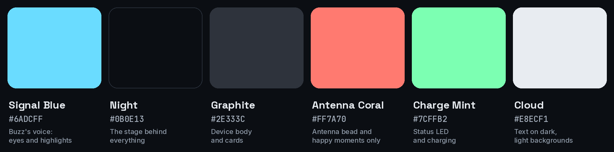
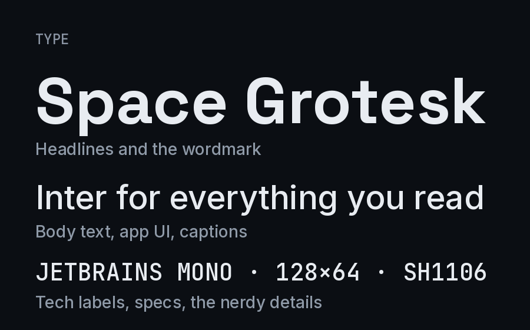

# Buzz Brand Kit

Buzz is a pocket-sized OLED robot that snaps onto the back of your phone with MagSafe and reacts to what your phone is doing. The whole identity is built from one idea: **the Signal eyes**, two eyes made of three vertical bars each.

Draft v0.1. The live design canvas with the product renders, expression sheet, MagSafe moments, brand board and launch poster is here: [Buzz design canvas](https://claude.ai/artifact/UBNi8u4BpjFfJH67cY94TY).

## Logo

| On dark (default) | On light |
|---|---|
|  |  |

- **Signal mark:** two eyes of three rounded bars each, the middle bar tallest. It's Buzz's Idle face, so the logo literally is the character.
- **Wordmark:** lowercase **buzz** in Space Grotesk Bold with tight letter spacing.
- On dark backgrounds the mark glows in Signal Blue. On light backgrounds it goes solid Night with no glow.
- The small coral dot is the antenna bead. Use it as an accent only, never as part of the mark itself.
- Keep clear space around the lockup equal to the height of one short bar.

## App icons

| Icon | Use |
|---|---|
| [Night](brand/icon-night.png) | Default everywhere: app, website, profile pictures |
| [Light](brand/icon-light.png) | Print and packaging |
| [Happy coral](brand/icon-coral.png) | Social posts, stickers, merch. Shows the Happy face (bars in an arch) |

## Color

| Name | Hex | Use |
|---|---|---|
| Signal Blue | `#6ADCFF` | Buzz's voice: the eyes, highlights, links |
| Night | `#0B0E13` | The stage behind everything |
| Graphite | `#2E333C` | Device body, cards, secondary surfaces |
| Antenna Coral | `#FF7A70` | Antenna bead and happy moments only |
| Charge Mint | `#7CFFB2` | Status LED and charging |
| Cloud | `#E8ECF1` | Text on dark, light backgrounds |

Night is the stage and Signal Blue is Buzz's voice. Coral should feel special, so keep it rare.

## Type

| Font | Use |
|---|---|
| [Space Grotesk](https://fonts.google.com/specimen/Space+Grotesk) | Headlines and the wordmark |
| [Inter](https://fonts.google.com/specimen/Inter) | Body text, app UI, captions |
| [JetBrains Mono](https://fonts.google.com/specimen/JetBrains+Mono) | Tech labels, specs, the nerdy details |

All three are free on Google Fonts.

## Voice

**Personality:** Playful, Responsive, Loyal.

**Tagline options:**

- Always on your wavelength.
- Snap it on. Feel the signal.
- Your phone finally has a face.

## Rules for the eyes

1. **Bars carry the emotion.** Height is feeling, motion is energy.
2. **Symbols are a last resort.** Add a pixel symbol (heart, Zz, !, ?) only when the bars can't say it alone.
3. **Always glow on black.** Never put the eyes on a busy or light background on screen.
4. **The snap-on boot is the sound-and-light logo.** Bars light up one by one, then a Happy hello with a rising chirp and the antenna flashing. Keep it identical everywhere: the device, the app launch and video intros.
5. **Real pixels only.** Marketing shots of the screen should use the actual 128x64 frames from `docs/expressions/` so what people see matches the product.

## Marketing moments to film

- **Snap on:** the signature moment for launch videos
- **Vibing:** music playing with the equalizer eyes
- **My turn:** phone face down, Buzz becomes the only face showing
- **Say cheese:** Buzz faces the person being photographed

See every expression animated in the [main README](../README.md#signal-eyes).
